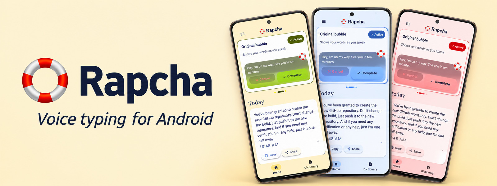
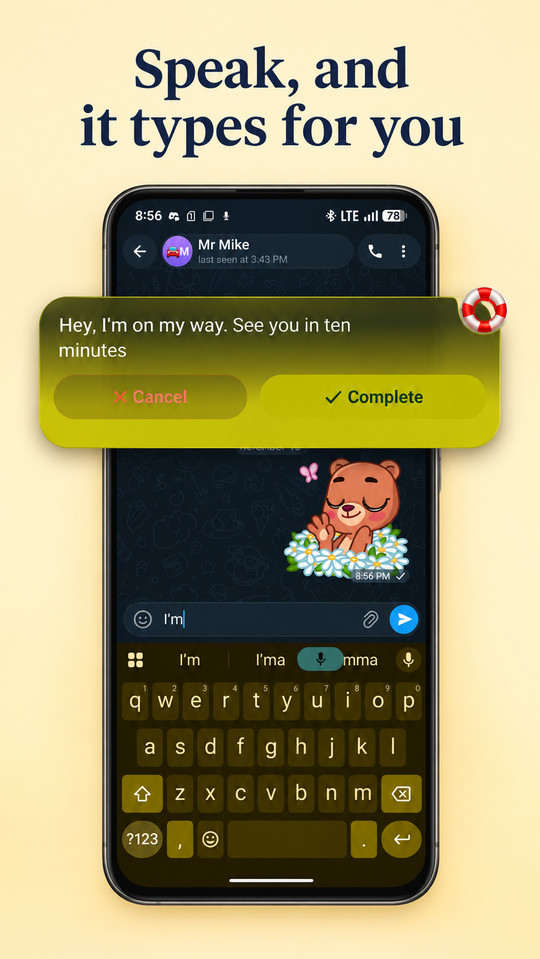
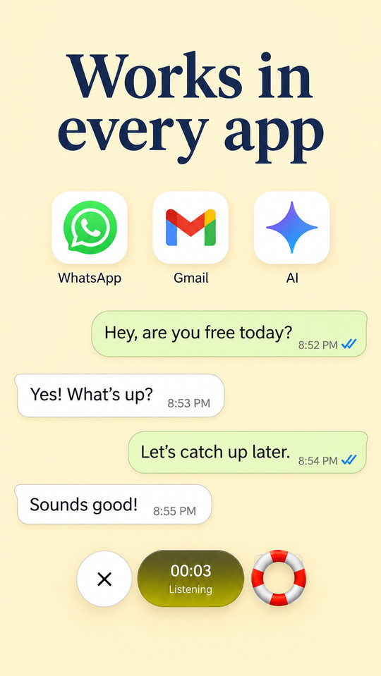
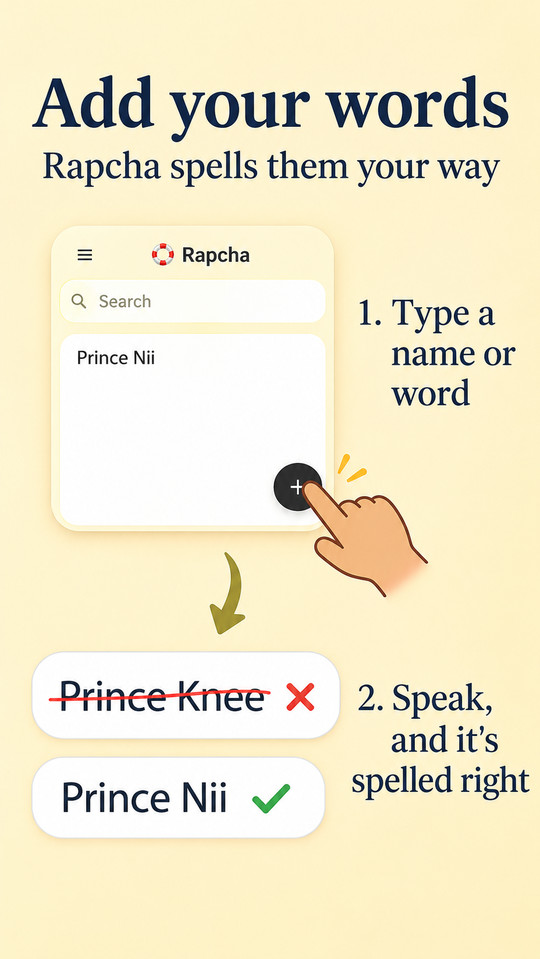

  

<h2 align="center">
  
  Rapcha
</h2>

  
  
  
  

  Voice typing for Android. Tap the bubble, speak, and your words are typed for you in any app.

  
  
  

  

<table>
  <tr>
    <td></td>
    <td></td>
    <td></td>
  </tr>
</table>

## How to install

1. Tap **Install**.
2. Open the file when it finishes downloading.
3. If your phone asks, allow **Install unknown apps**.
4. Tap **Install**.

If Play Protect warns, tap **More details** and then **Install anyway**.

## For developers

This is the full source. Build with `./gradlew assembleDebug`.
New versions are built automatically when code is pushed to main.
